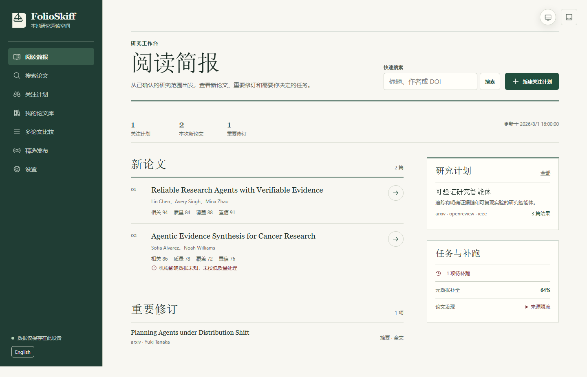

# 页舟 · FolioSkiff

[简体中文](README.zh-CN.md)

FolioSkiff is a local research workspace for discovering papers, reading and annotating PDFs, and tracing findings back to their sources. You can switch between English and Simplified Chinese while keeping the current paper, filters and drafts.



The current source targets `3.2.0`. The Windows installer and portable package are produced by the verified GitHub Actions release workflow; see the [release guide](docs/testing-release.md) and [implementation status](docs/implementation-status.md) for the current evidence.

## Features

- Turn a natural-language research intent into editable bilingual concept groups; only a confirmed immutable keyword version can run discovery.
- Discover papers by calendar month from arXiv, OpenReview, Europe PMC, IEEE Xplore, and Springer Nature through extensible connectors.
- Rank with separate relevance, objective quality, confidence, and evidence-coverage scores rather than one opaque number.
- Keep canonical works, document versions, PDFs, annotations, reading state, preferences, reports, conversations, and comparisons in a local SQLite-backed library.
- Read PDFs with search, zoom, rotation, bookmarks, annotations, text extraction, and on-demand OCR.
- Generate structured reports or converse about a paper through Codex CLI, Ollama Local, or Ollama Cloud only after an explicit user action.
- Back up and restore local data, run isolated plugins, and publish a privacy-filtered selection to a separate Git branch.
- Run as a single local service bound to `127.0.0.1`; no account, team service, or telemetry is required.

| Capability | Current status |
|---|---|
| Research plans, confirmed keywords, and five source connectors | Available |
| Recommendation, scoring evidence, and preference learning | Available |
| PDF library, OCR, annotations, and document versions | Available |
| Codex/Ollama reports, paper conversation, and comparison | Available |
| Backups, plugin isolation, and curated publishing | Available |
| Windows installer and portable package | v3.2.0 release workflow with manifest, SBOM, hashes, and attestation |
| Unified ask/explain/translate/related-resource assistant | Available |

## Quick start

### Installer or portable package

Download the Windows installer or portable ZIP and its SHA-256 file from [GitHub Releases](https://github.com/Lisalsj/folioskiff/releases). The application starts a loopback-only service and opens the browser automatically. Python and Node.js are not required for packaged builds.

For an earlier 3.x installation, download and run the 3.2.0 installer once. It uses the existing program directory and library. To check for a later release, open **Settings → About → App updates** and select **Check now**. FolioSkiff checks GitHub only when you ask.

### Run from source

Development requires Windows 11 x64, Python 3.12 managed by `uv`, Node.js 24, npm, and Git.

```powershell
uv sync --locked --extra dev
npm ci
npm run build
uv run paper-reader serve
```

Use `uv run paper-reader serve --no-browser` when the browser should not open automatically.

### First-use configuration

Start with the [Windows getting-started guide](docs/getting-started.md) and the step-by-step [first-run setup guide](docs/first-run-setup.md).

1. Choose one data root (default: `Documents/paper-reader`); state, cache, library, and backups are derived beneath it. Keep it outside the Git checkout.
2. Start with the free sources: arXiv, OpenReview, and Europe PMC.
3. Add IEEE Xplore, Springer Nature, or OpenAlex keys in Settings only if you have obtained them from the official provider.
4. Select Codex CLI or Ollama as the optional Agent backend and run its capability check. Keyword generation uses this default backend and reports the requested and resolved model.
5. Create a research plan, review the model-generated concept groups, confirm the keyword version, select a month range, preview source results, and then run it.

Missing API keys or models do not prevent startup. Paid sources remain visibly disabled, semantic retrieval falls back to lexical retrieval, and keywords can always be edited manually.

## AI and network boundary

- Loading a page, opening a PDF, selecting text, or receiving a recommendation never starts a model request.
- Analysis begins only after the user clicks **Analyze** and reviews backend, model, reasoning effort, language, evidence scope, prompt, and networking settings.
- Codex and Ollama Cloud are cloud-capable backends and are labeled as such. Ollama Local uses the local API.
- Codex uses its own login state; `paper-reader` does not copy Codex credentials or edit `~/.codex/config.toml`.
- Credentials are stored through the operating-system credential store and are excluded from logs and backups.
- External research is a separate opt-in capability. Local paper analysis does not silently browse the web.
- Paper text is untrusted evidence, never system instruction. Agent output cannot change scores, ranking, feedback, or existing reports.

See [security and privacy](docs/security-privacy.md) for the full trust boundary.

## Architecture

The Python 3.12 FastAPI service hosts the Vue 3 SPA and `/api/v1`. SQLite, FTS5, optional `sqlite-vec`, content-addressed document storage, persistent jobs, and resumable SSE keep the application local and restart-safe. PDF.js renders documents; optional ONNX models provide multilingual embeddings and OCR. PyInstaller and Inno Setup produce the Windows distributions.

## Documentation

- [Documentation index](docs/README.md)
- [Getting started on Windows](docs/getting-started.md)
- [First-run setup](docs/first-run-setup.md)
- [AI reading assistant](docs/ai-reading-assistant.md)
- [Codex and Ollama setup](docs/codex-ollama-setup.md)
- [Troubleshooting](docs/troubleshooting.md)
- [Product requirements](docs/product-requirements.md)
- [Architecture](docs/architecture.md)
- [Data model](docs/data-model.md)
- [Connectors](docs/connectors.md)
- [Recommendation and scoring](docs/recommendation.md)
- [Agent analysis](docs/agent-analysis.md)
- [Testing and release](docs/testing-release.md)
- [Active optimization design](docs/superpowers/specs/2026-07-31-repository-optimization-design.md)
- [Active execution index](docs/superpowers/plans/2026-07-31-repository-optimization-index.md)

## Contributing

Read [CONTRIBUTING.md](CONTRIBUTING.md) before proposing a change. Contributions use test-driven development, Conventional Commits, privacy-safe fixtures, synchronized OpenAPI types, and the documented Windows quality gates.

Report security issues privately according to [SECURITY.md](SECURITY.md). For ordinary support and issue routing, see [SUPPORT.md](SUPPORT.md).

## Historical local release evidence

`paper-reader@1.0.0` 在冻结提交 `b3490b0` 完成了本地源码、安全、发行物、安装/升级和性能硬门禁。该记录是历史收据，不代表当前 `main` 已重新冻结；详见 [v1.0.0 本地发行收据](docs/v1-local-release-receipt.md)。

## License and citation

Licensed under [Apache-2.0](LICENSE). Citation metadata is available in [CITATION.cff](CITATION.cff).
