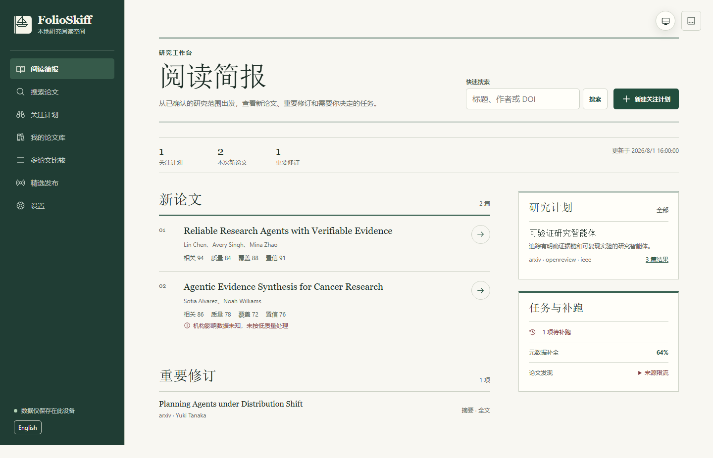

# 页舟 · FolioSkiff

[English](README.md)

页舟是个人研究者的本地论文工作台。可以从研究问题出发发现论文，阅读和批注 PDF，并沿引用回到证据原文。工作中可随时切换中英文界面，保留当前论文、筛选条件和草稿。



当前源码目标版本为 `3.2.0`。Windows 安装包与便携包由经过验证的 GitHub Actions 发布流程生成；当前证据和剩余边界见[发布与测试指南](docs/testing-release.md)和[实施状态](docs/implementation-status.md)。

## 功能

- 将自然语言研究意图整理为可编辑的双语概念组；只有用户确认的不可变关键词版本可以启动检索。
- 按自然月从 arXiv、OpenReview、Europe PMC、IEEE Xplore、Springer Nature 获取论文，并可扩展新的连接器。
- 分别展示相关性、客观质量、置信度与证据覆盖度，不用单一黑箱分数掩盖缺失数据。
- 在本地库中保存规范论文身份、文档版本、PDF、标注、阅读状态、偏好、报告、聊天与比较结果。
- 支持 PDF 搜索、缩放、旋转、书签、标注、文本提取和按需 OCR。
- 只有用户主动操作后，才通过 Codex CLI、Ollama Local 或 Ollama Cloud 生成结构化报告或交互式分析论文。
- 支持备份恢复、隔离插件，以及把经过隐私筛选的精选内容发布到独立 Git 分支。
- 单一服务仅监听 `127.0.0.1`；无需平台账户、团队服务或遥测。

| 能力 | 当前状态 |
|---|---|
| 研究计划、确认关键词与五个来源连接器 | 可用 |
| 推荐、评分证据与偏好学习 | 可用 |
| PDF 论文库、OCR、标注与文档版本 | 可用 |
| Codex/Ollama 报告、论文聊天与比较 | 可用 |
| 备份、插件隔离与精选发布 | 可用 |
| Windows 安装包与便携包 | v3.2.0 发布流程提供 manifest、SBOM、哈希和 attestation |
| 统一提问、解释、翻译与相关资源助手 | 可用 |

## 快速开始

### 安装包或便携包

从 [GitHub Releases](https://github.com/Lisalsj/folioskiff/releases) 下载 Windows 安装包或便携 ZIP，并核对同版本 SHA-256。应用会启动仅限回环地址访问的本地服务并自动打开浏览器；成品运行不需要 Python 或 Node.js。

3.x 用户请手动下载安装 3.2.0 一次。安装程序会沿用已有安装目录和本地论文库，后续更新由 FolioSkiff 仓库提供。

### 从源码运行

开发环境需要 Windows 11 x64、由 `uv` 管理的 Python 3.12、Node.js 24、npm 和 Git。

```powershell
uv sync --locked --extra dev
npm ci
npm run build
uv run paper-reader serve
```

如不希望自动打开浏览器，使用 `uv run paper-reader serve --no-browser`。

### 初次配置

请先阅读 [Windows 开始使用指南](docs/getting-started.md)和逐步的[首次配置指南](docs/first-run-setup.md)。

1. 选择一个数据根目录（默认是 `文档/paper-reader`），状态、缓存、论文库和备份会自动使用固定子目录；它应位于 Git 仓库之外。
2. 先使用无需密钥的 arXiv、OpenReview 和 Europe PMC。
3. 如已从官方渠道取得密钥，再在设置中启用 IEEE Xplore、Springer Nature 或 OpenAlex。
4. 可选 Codex CLI 或 Ollama 作为 Agent 后端，并执行能力检测。生成研究关键词时会调用这里的默认后端，并显示请求模型与实际模型。
5. 新建研究计划，检查模型生成的概念组，确认关键词版本，选择月份范围，预览各来源结果，然后运行。

没有 API key 或本地模型时，应用仍可启动。付费来源会明确显示为禁用，语义检索会降级为词法检索，关键词始终可以手工编辑。

## AI 与联网边界

- 页面加载、打开 PDF、选择文本和显示推荐都不会自动调用模型。
- 只有点击“分析”并检查后端、模型、推理强度、语言、证据范围、提示词与联网设置后，才生成正式报告。
- Codex 和 Ollama Cloud 是可使用云端的后端，界面必须明确标识；Ollama Local 使用本机 API。
- Codex 复用自己的登录状态；`paper-reader` 不复制 Codex 凭据，也不修改 `~/.codex/config.toml`。
- 凭据由操作系统凭据库保存，不进入日志与备份。
- 外部网络研究是单独的主动选择；本地论文分析不会静默上网。
- 论文正文是不可信证据，不是系统指令。Agent 输出不能修改评分、排序、反馈或已有正式报告。

完整信任边界见 [安全与隐私](docs/security-privacy.md)。

## 架构

Python 3.12 FastAPI 服务同时提供 Vue 3 SPA 与 `/api/v1`。SQLite、FTS5、可选 `sqlite-vec`、内容寻址文档存储、持久任务和可恢复 SSE 让应用保持本地化并能在重启后恢复。PDF.js 负责渲染，可选 ONNX 模型提供多语言向量与 OCR。Windows 制品由 PyInstaller 和 Inno Setup 构建。

## 文档

- [开发文档索引](docs/README.md)
- [Windows 开始使用](docs/getting-started.md)
- [首次配置](docs/first-run-setup.md)
- [论文 AI 阅读助手](docs/ai-reading-assistant.md)
- [Codex 与 Ollama 配置](docs/codex-ollama-setup.md)
- [故障排查](docs/troubleshooting.md)
- [产品需求](docs/product-requirements.md)
- [系统架构](docs/architecture.md)
- [数据模型](docs/data-model.md)
- [来源连接器](docs/connectors.md)
- [推荐与评分](docs/recommendation.md)
- [Agent 分析](docs/agent-analysis.md)
- [测试与发布](docs/testing-release.md)
- [当前优化设计](docs/superpowers/specs/2026-07-31-repository-optimization-design.md)
- [当前执行索引](docs/superpowers/plans/2026-07-31-repository-optimization-index.md)

## 参与贡献

提交改动前请阅读 [CONTRIBUTING.md](CONTRIBUTING.md)。项目使用测试驱动开发、Conventional Commits、隐私安全的测试样本、同步生成的 OpenAPI 类型以及明确的 Windows 质量门槛。

安全问题必须按 [SECURITY.md](SECURITY.md) 私下报告；普通支持与问题分流见 [SUPPORT.md](SUPPORT.md)。

## 许可证与引用

项目使用 [Apache-2.0](LICENSE) 许可证；引用元数据见 [CITATION.cff](CITATION.cff)。
