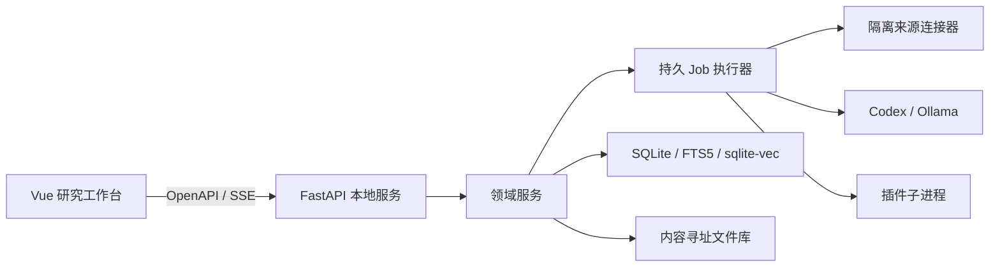

# 系统架构

## 1. 形态

应用是单进程本地模块化单体：Python 服务动态绑定 `127.0.0.1` 端口，同时提供 Vue SPA 与 `/api/v1`。长任务通过持久 Job 状态机运行；SQLite 是唯一必需数据库，不引入 Electron、Redis、Celery 或独立数据库服务。

## 2. 后端模块边界

- `api`：HTTP schema、鉴权、幂等键、SSE，不包含评分或抓取规则。
- `domain`：Work、计划、关键词、评分、库状态、报告等业务约束。
- `connectors`：官方来源查询编译、分页、限流和响应归一化。
- `enrichers`：OpenAlex、Semantic Scholar、Crossref、代码/模型证据。
- `retrieval`：FTS5、E5 向量、布尔规则、排序与探索配额。
- `agents`：关键词建议、Codex/Ollama 报告、聊天与比较适配。
- `assets`：E5/OCR 等可选模型的关闭式清单、受验证下载、持久 Job、版本共存、活动指针和引用保护。
- `reader`：本地库成员、引用/PDF 导入、内容寻址存储、下载、文本提取、OCR、页级证据和标注迁移。DOI、BibTeX 与 URL 引用导入只写 Work/SourceRecord/LibraryEntry；只有明确的全文动作才能进入文档获取边界。
- `backups`：SQLite 一致快照、便携归档、可选流式加密、完整恢复验证、定时策略和启动前 journal 事务；不拥有凭据、模型或缓存。
- `jobs`：状态机、进度、检查点、取消、重试、幂等和错误分类。
- `plugins`：发现、权限、子进程协议与熔断。
- `publishing`：隐私白名单、临时 worktree 和 `published` 分支。

依赖方向必须从接口层指向领域应用层，再指向基础设施适配器。连接器、Agent 和插件不能直接修改评分、用户反馈或其他聚合根。

### 2.1 前端模块边界

Vue 路由页只拥有路由参数、API 调用、持久 Job 跟踪和跨组件编排。稳定的研究工作流放在
`web/src/features/<feature>`：组合式函数拥有可清理的异步状态，展示组件接收只读类型化
视图状态并发出用户命令，不直接调用 API。PDF、阅读器、比较、精选发布与设置均通过
路由级动态导入保持在按需 chunk；`PdfReader` 保留兼容门面，使页面和底层 PDF.js 生命周期
不会同时变化。比较与精选发布页面分别冻结比较选择/证据预检，以及公开白名单/发布任务
边界；子组件不保存凭据、本机私有路径或业务状态，也不自行运行 Agent 或 Git。

## 3. 本地数据层

SQLite 启用 WAL、外键和 5 秒 busy timeout；所有 schema 变化只通过 Alembic。FTS5 始终可用，`sqlite-vec` 不可用时退化到词法检索并降低置信度。PDF、抽取文本、OCR 和派生文件用 SHA-256 内容寻址，数据库只保存关系、状态与路径引用。

插件发现是纯 metadata 阶段：主进程只枚举 `paper_reader.plugins` entry point 的
name/value/distribution/version，不加载模块。受限 worker 以后才解析经过语法验证的
`module:attribute`。manifest v1、协议范围、五类方法、关闭式配置 schema 和抽象权限
先规范化并哈希；installation 默认禁用，代码身份变化使当前 grant 失效。JSONL 帧以
UUID、UTC deadline、连续 sequence、唯一终态及单行/总量上限形成可独立熔断的边界。

本地库列表使用 `/api/v1/library/works`，独立偏好状态继续使用 `/api/v1/library/works/{work_id}`；规范论文详情和版本列表分别使用 `/api/v1/works/{work_id}` 与 `/api/v1/works/{work_id}/documents`。页级证据通过 `/api/v1/works/{work_id}/documents/{document_version_id}/pages` 读取，原生文本与未来 OCR 字段分别保存，响应中的 `text_source` 明确当前采用哪类证据。这样“是否加入库”“喜欢/置顶/进度”和论文事实保持为可独立演进的接口，不用同一路由返回含义不同的对象。

阅读链路采用显式边界而不是隐式抓取：论文库的导入面板调用 PDF 或引用导入接口；引用导入只形成 Work/SourceRecord/LibraryEntry，PDF 导入才形成内容哈希与 DocumentVersion。阅读器只通过受保护内容路由读取字节，位置和批注分别写入当前不可变版本。新版本出现后，迁移服务冻结旧批注、目标文本与算法版本并生成候选；用户逐条接受后才创建目标批注，拒绝或未决定都不改动源版本。

## 4. 启动与安全边界

启动器先在用户状态根取得内核持有的单字节独占锁；锁句柄不可继承，`instance.json`
永远不能替代所有权。只有锁拥有者才能创建 App，先完成恢复/迁移，再预占回环 socket
并启动 Uvicorn。Uvicorn 报告 startup 成功后，启动器才原子发布带当前用户受保护 DACL
的 `instance.json`，并打开浏览器；文件只含 schema、PID、创建时间、回环端口和随机
activation secret。正常退出删除匹配的状态文件，异常退出由 Windows 内核释放锁。

第二个进程取得锁失败后不会创建 App、数据库、迁移、Job 或 socket。它读取有界、
关闭式状态文件，绕过代理直连 `127.0.0.1`，提交 activation secret 并核对服务返回的
PID；已有实例据此签发 5 分钟有效、只可兑换一次的新 bootstrap token。错误 PID、
端口复用、链接/reparse point、非回环客户端、外部 Origin、超过 1 KiB 的请求、重放、
过期和停服竞态都安全拒绝。新旧启动都把 bootstrap token 只放在 URL fragment；SPA
在其他操作前交换 HttpOnly、SameSite=Strict 会话 cookie 并清除 fragment。所有变更
请求继续验证会话、严格回环 Origin 和双提交 CSRF；服务从不监听局域网地址。

已确认的恢复具有更早的优先级：启动时先恢复可能中断的双根 journal，再处理新的 pending restore；只有数据库/WAL/SHM 与对象树均完成发布、`quick_check`/外键检查、迁移和无路径收据写入后，才创建普通数据库引擎和后台服务。失败会在打开 socket 或浏览器前以稳定错误码停止，保留完整旧状态或可继续 journal。应用随后才建立内容目录、运行常规迁移和恢复允许自动继续的 Job；从备份带回的旧活动 Job 已预先标记中断，不会重放外部副作用。

## 5. 长任务

命令返回 HTTP 202 与持久 `Job`。执行器按小步骤提交检查点；崩溃后只继续未完成步骤。相同幂等键返回原 Job。报告与聊天片段先持久化再通过可恢复 SSE 发送，客户端断线后用 `Last-Event-ID` 继续，轮询作为回退。

Discovery 当前已实现 `POST /plans/{id}/preview` 与 `POST /plans/{id}/runs` 两类 202 命令。Job 详情通过 `/jobs/{id}` 返回结果、检查点和结构化错误，PlanRun 通过 `/runs/{id}` 展示各月份来源批次。应用生命周期管理器只在程序打开时运行任务；关闭时先取消协程再关闭共享 HTTP 客户端，数据库中遗留的 `queued`/`running` PlanRun 在下次启动时按已持久化游标恢复。

`reader.extract_document` 由后台执行器监督短命原生 worker，不阻塞本地 HTTP 事件循环，也不在主服务进程加载 PyMuPDF。worker 通过固定 JSONL/结果收据协议返回整份页证据；父进程重新验证页号、几何、块、扫描状态、总量、结果字节和 SHA-256，只有全部成功才用一个事务替换页面结果。一个 deadline 覆盖启动、请求写入、状态、收据和进程退出；超时、取消或应用关闭会终止 worker 并关闭 Windows Job handle，残留原生调用不能延迟退出。应用关闭仍保留 Job 为 `running` 供下次恢复，用户明确取消才形成 `cancelled` 终态。

`models.install` 是 E5 与 OCR 共用的模型获取入口：只有用户显式确认后才读取内置关闭式清单，下载固定 revision 的固定资产。下载 Job 保存强 ETag、已验证部分哈希和字节检查点；暂停保留同版本 `.part`，继续复用原 Job，取消清理未完成字节。只有大小、SHA-256、落盘同步和运行时激活检查全部通过的 revision 才能进入活动指针；同一 bundle 的旧 revision 可以共存，但活动、运行中或仍被任务/索引引用的版本不能删除。应用启动只自动恢复 `queued/running`，`paused` 必须由用户继续。旧的 `reader.install_ocr_models` 持久任务仍兼容恢复，但新请求统一走模型资源协议。

E5 没有活动版本时，推荐明确降级为词法检索并降低置信度；启用已验证 revision 后可在不重启应用的情况下创建新的语义索引。OCR 能力探测用隐藏短命子进程验证可选原生库能否真实导入，DLL 失败只形成降级原因，不污染主服务进程。`reader.ocr_document` 只读取已经被原生提取标记为扫描页的页面，并把渲染与惰性 RapidOCR/ONNX 调用放入同类受监督 worker；应用启动、普通提取和父服务都不会加载 OCR 原生运行时。识别 Job 在创建时冻结活动模型 revision，父进程在保存前重新核验合法访问状态、文档哈希、页尺寸、原生证据指纹、页/行/字符预算和结果收据，再以单事务写入独立 OCR payload、置信度、引擎版本与模型包 ID。

设置页用同一个模型生命周期界面呈现 E5 与 OCR，不在浏览器重算权限、完整性或引用规则。`current_release` 明确区分随当前应用发布的固定 revision 与本机保留旧版；只有当前发布且未完整校验的版本提供下载入口，已校验版本仍需显式启用。`GET /api/v1/settings/model-assets/jobs` 按资产返回最新持久模型任务，不受全局任务抽屉最近 100 条摘要的限制；暂停、继续、取消、失败重试和刷新恢复都使用服务端进度，专用响应不包含原始错误文本。下载与旧版删除各自经过明确确认，删除前仍由服务端返回引用与可释放空间预览。

论文全文缓存保持为独立设置区，不再保留第二套旧 OCR 下载入口。缓存清理先由服务端生成包含保护证据的预览令牌，应用时再次核验令牌。任务抽屉继续把内部 Job kind 映射为用户可读名称，并为 `models.install` 提供持久暂停/继续控制；终态任务不会继续显示“正在取消”。

`publishing.publish` 把用户确认的只读预览先冻结为不可变 `PublishedSnapshot`，Job 只引用快照和 Git 目标指纹。执行前再次诊断固定 `origin/published` 目标；执行器在线程中创建 detached、无 checkout 的缓存 worktree，以 plumbing 命令生成仅含 Pages workflow 与三项站点文件的提交，再用非强制 refspec 推送。发布分支不存在时使用独立空根，存在时接续远端最新 head。取消、失败和服务关闭都会协作清理已登记 worktree；失败快照保留，只有显式重试才建立新 Job 并复用同一字节。该适配器只允许对象库、临时 worktree 与固定远端发生变化，源码工作树的 HEAD、分支和文件状态不属于其写入面。

## 6. v0.6 平台工件边界

| 工件 | 固定内容 | 明确不包含/不执行 |
|---|---|---|
| `paper-reader-backup-v1` | `manifest.json`、SQLite online-backup 单文件、数据库引用且哈希有效的内容寻址 PDF | 凭据、WAL/SHM 原副本、模型、向量/cache、日志、临时文件、旧备份、未引用对象 |
| 密码便携包 | 版本化二进制头、Scrypt 参数/salt、AES-256-GCM nonce、加密归档和认证标签 | 密码、明文临时包、可降级的未认证数据 |
| 插件 distribution | `paper_reader.plugins` entry point metadata、manifest v1、显式 handler 与包内资源 | 主进程 `.load()`、数据库/repository 注入、任意文件/网络/凭据、普通 subprocess 后备路径 |
| `PublishedSnapshot` | 白名单公开 payload、选择/依赖指纹、`index.html`、`data.json`、`manifest.json` 的冻结字节与哈希 | PDF/全文、批注/聊天/行为/偏好、凭据、完整提示词、失败草稿、未选报告 |
| `published` 提交 | `.github/workflows/pages.yml` 与 `site/index.html`、`site/data.json`、`site/manifest.json` | 源码分支文件、构建脚本、hook/filter/signing、force push、用户工作树修改 |

备份恢复的 `pending-restore.json` 与双根 journal 位于应用专用状态根，不是普通数据库业务实体。启动器必须先完成 journal 继续/回滚与 pending 应用，再创建数据库引擎、HTTP socket 或浏览器。插件作者的可执行入口见[插件 SDK 开发指南](plugin-sdk.md)；协议与隔离事实见[插件协议](plugins.md)。精选发布固定目标、Pages 文件清单和故障恢复见[安全与隐私](security-privacy.md#6-隐私与保留)。

## 7. v0.8 冻结资源边界

Windows 运行包中的资源只通过 `importlib.resources` 解析，不依赖启动时工作目录或
PyInstaller 私有的 `_MEIPASS` 细节。统一资源契约覆盖 SPA、Alembic、OCR/E5 清单、
Pages workflow、应用许可证与第三方声明；源码、wheel 和冻结运行时必须使用同一组
逻辑名称，缺少任一必需资源都在打开数据库或监听 socket 前失败。

| 边界 | 固定内容 | 约束 |
|---|---|---|
| Python 包资源 | SPA、迁移、模型 manifest、Pages workflow、许可证/声明 | 只读、版本随应用、不得在运行时覆写 |
| Windows onedir | `paper-reader.exe`、`_internal/`、许可证、第三方声明和发行 manifest | 不携带模型权重、数据库、PDF、备份、凭据、日志或开发文件 |
| 用户可变状态 | 数据库、对象库、模型、缓存、日志和备份 | 只能由 `AppPaths` 定位到用户目录；不得回落到安装目录 |

内置 E5 与 OCR manifest 使用同一关闭式 JSON 契约：bundle、固定 revision、资产
URL、相对路径、字节数、SHA-256、许可证和用途必须完整且通过校验。每个 revision
安装在独立用户模型目录，数据库活动指针只指向已完整验证的一个版本；API 只公开用途、
许可、来源、字节数、状态、版本身份、是否为当前发布以及不含原始诊断的持久任务事实，
不公开下载 URL、查询参数、本机路径或底层错误文本。安装目录即使
只读、位于非 ASCII 或长路径下，资源发现也不得产生写入；按需下载仍进入用户模型目录。
发行布局另由
`packaging/release-layout.json` 作为构建和扫描的唯一事实来源，后续便携包与安装器
必须复用同一份已扫描 onedir 字节。

## 8. 关键 ADR

- [ADR-0001：本地模块化单体](adr/0001-local-modular-monolith.md)
- [ADR-0002：Work 稳定身份与版本](adr/0002-work-identity.md)
- [ADR-0003：按需 Agent 与评分隔离](adr/0003-agent-score-separation.md)

## 9. v0.8 只读更新检查

更新检查是独立的 `updates` 模块，不复用来源、文档下载、Agent 或插件 HTTP 客户端。它只向固定的 `https://api.github.com/repos/Lisalsj/folioskiff/releases/latest` 发起无请求体 GET，使用固定 GitHub API 版本、Accept 与不含设备标识的 `paper-reader/<version>` User-Agent；客户端禁用环境代理和重定向，并限制连接、读取、响应头与正文大小。每次请求前清空 cookie，因此 GitHub 意外返回的 cookie 也不会在后续检查中回送。

Release 正文必须包含唯一的 `paper-reader-update-manifest:v1` 注释块。该块冻结版本、纯文本变更、迁移说明、能力矩阵、签名状态和必需资产名称；同一 Release 的资产列表还必须含 `release-manifest.json` 及摘要声明的所有名称。应用只核对 GitHub `releases/latest` 响应中已有的公开字段，不读取资产 URL，不下载清单、安装器或便携包。发行元数据生成器从同一规范事实同时生成 Release 注释块和完整 `release-manifest.json`，避免两份人工维护数据漂移。

`UpdateService` 将成功状态归类为当前版、新版、服务器旧版、预发布或草稿，将限流、离线、损坏响应和 GitHub 5xx 映射为关闭式错误状态。有效公开元数据与粗粒度状态/检查时间进入 SQLite；原始响应、响应头、cookie、网络异常、路径和用户数据不持久化。应用升级后会用当前版本重新计算缓存版本关系，避免旧的“可更新”状态跨版本残留。

正式启动器在应用打开时提交一次 `check_if_due`，数据库时间门槛保证 24 小时内至多一次；关闭自动检查后不创建网络请求。手动检查必须来自本地会话、Origin/CSRF 保护的显式按钮。后端没有更新资产下载、执行或重启 API，前端二次确认后也只打开通过固定仓库校验的 HTTPS Release 页面。

## 10. Windows onedir 发行结构

PyInstaller 采用 `onedir` 而不是自解压 `onefile`。构建器先在锁定且无 editable 安装的 Python 3.12 环境生成候选目录，再复制许可证、写入规范化逐文件 SHA-256 清单，执行内容审计和真实启动 smoke，最后才把候选目录原子替换为可发布目录；任何构建、扫描、启动或复制失败都保留上一成功目录。

spec 按文件后缀白名单收集项目资源，避免把源码 `__pycache__` 或构建缓存带入包；FastEmbed 和 RapidOCR 只携带代码、配置与运行时，权重始终由用户确认后下载到 `AppPaths.models`。每个 `.exe/.dll/.pyd` 必须是 x64 PE，根目录恰有一个 GUI 入口。`release-manifest.json` 不记录构建机根路径或时间，而是固定身份、版本、布局、排序后的路径/大小/SHA-256 和超大文件清单，后续 ZIP、安装器与发布元数据都必须消费这组已审计字节。

冻结 smoke 不继承开发工具 PATH 或凭据环境，使用独立的状态、缓存和论文库根。启动器在只读程序目录中完成回环服务、静态站点、OpenAPI 和 WAL 数据库验证，并通过隐藏的有界自动退出参数正常关闭。该参数和 ready 文件只用于发行验收，不改变普通用户启动流程。

## 11. 便携包与每用户安装器

便携 ZIP 和 Inno Setup 安装器只消费同一个通过 `release-manifest.json` 审计的
onedir，不分别重建运行时。ZIP 固定单一 `paper-reader/` 顶层、规范化排序、1980
时间戳和只读普通文件权限；打包后重新逐成员计算大小与 SHA-256，并与源目录精确
比较。相同 onedir 重复生成的 ZIP 必须逐字节一致，发布提升同时保护旧 ZIP 与旧安装器，
任何一项失败都回滚整组候选。

安装器固定 AppId `{381B261E-B659-4B56-855E-ADDE80CC5BD2}`，只允许 Windows 11
x64 compatible，以 `PrivilegesRequired=lowest` 安装到当前用户 Local Programs。
开始菜单入口始终创建，桌面入口和安装后启动默认不选；不注册服务、计划任务、开机
启动、PATH、文件关联、防火墙或全局组件。安装过程不可中途取消，也不会关闭、重启或
强杀正在运行的应用；用户仍可在真正复制前取消。

资料库文件锁仍是单实例所有权的唯一事实。只有成功取得该锁的服务进程才创建
`Local\paper-reader-installer-running-v1` 命名标记，Inno 在安装、升级和卸载前检查它；
第二个安装版或便携版进程只激活已有服务，不取得新的资料库所有权。相同 AppId 升级
复用安装位置并恢复被修改的程序文件，未知文件不会进入卸载清单；比已安装版本更旧的
候选在 `PrepareToInstall` 阶段以非零退出码停止。

默认卸载只移除清单内程序和快捷方式。交互式卸载可另外选择默认目录中的模型、缓存、
日志，或在输入 `DELETE PAPER DATA` 后选择默认 Documents 下的对象库与备份；静默
卸载永远不选择这些项目。清理器只接受关闭式默认路径，先限制深度和成员数并拒绝任何
reparse point；环境覆盖、自选迁移目录、数据库和凭据均不在递归删除入口中。

## 12. 可审计发行元数据

完整发行采用一个临时 staging 目录组装并验证，只有全部成功后才原子提升。目录固定为
十个普通文件：安装器、便携 ZIP、Python 与 npm 两份 CycloneDX 1.6 SBOM、
`CAPABILITY_MATRIX.md`、`CHANGELOG.md`、`RELEASE_NOTES.md`、`UNSIGNED.md`、
`release-manifest.json` 和 `SHA256SUMS.txt`；缺少、额外、重名、大小写冲突、链接或
reparse point 都会使整组失败。安装器和 ZIP 继续绑定同一份已审计 onedir。

Python SBOM 必须由实际冻结构建环境中的绝对 Python 解释器生成，并核对其中已安装的
`paper-reader` 版本；npm SBOM 只读取仓库精确 `package-lock.json`，使用绝对 npm、
离线模式、空的临时 user/global npmrc 和 `--package-lock-only`，不读取用户 token 或
安装脚本。两份原始 SBOM 都规范化为确定性 CycloneDX 1.6 JSON，根组件由发行事实
统一为 `paper-reader@<version>`，缺失依赖许可证显式写为 `NOASSERTION`，依赖图必须
覆盖每个组件并通过官方严格 schema 校验。

版本、Git commit、API/plugin/database/bundle schema、迁移、能力矩阵、平台、签名状态
和资产记录只有一个规范事实源；生成器同时据此写 Release 注释块与 manifest，避免更新
检查摘要漂移。manifest 记录除自身和摘要文件外的八项资产；`SHA256SUMS.txt` 记录除
自身外的九项文件，避免自引用哈希。所有文本使用 UTF-8/LF，JSON 规范排序；独立
`verify` 命令从磁盘重新验证封闭成员集、大小、SHA-256、SBOM schema/图/许可和派生
文本。v0.8 的 `signed` 固定为 `false`；参数化签名 hook 仅预留未来流水线能力。

## 13. 构建与验收隔离

Windows 发行使用三个单向阶段：质量 job 只验证源码，build job 只生成封闭 artifact，
verify job 只消费该 artifact。job 之间不共享工作区、Python 环境、Node 环境或进程；
verify runner 不 checkout 源码，因此候选不能在验收时回退到开发解释器、仓库静态资源
或未打包脚本。artifact 自带的验证器先以调用方传入的 manifest hash 固定身份，再验证
内部九项摘要和两层发行 manifest。

verify 期间程序目录只读，三个可变根位于隔离临时目录。临时防火墙只允许 IPv4 回环，
阻断该程序其余 IPv4 与全部 IPv6 的任意协议；本地 health/SPA 验证与离线边界因此同时
成立。安装、升级和卸载只使用本次临时 HKCU/安装根，固定卸载键预先存在即停止。完整
执行细节与 Sandbox 人工复核见[Windows 打包与干净环境验收](windows-packaging.md)。

## 14. v2 首次配置与统一 Assistant

`OnboardingService` 编排四步向导和恢复检查点，`RuntimeConfigStore` 只保存非敏感运行配置；凭据仍由操作系统凭据库拥有。前端 Assistant 通过版本化 API 把提问、解释、翻译、相关推荐投影为持久任务，不在组件内拼接后端命令。

每个 AI 或外部资源任务都冻结 `network_policy`。`local_only` 只允许已选择的论文、标注和本地元数据；`external_research` 必须来自当次用户确认。相关推荐分为“本地生成可审阅检索意图”和“确认后执行来源/外部资源查询”两个阶段，因此模型输出不能直接扩大网络权限。
